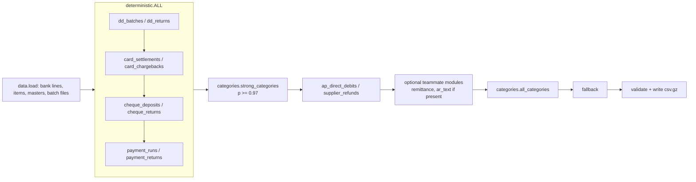

# talky-hackathon · Close the Books

Token Co.'s entry for the **Talky × Anthropic "Close the Books"** hackathon: bank reconciliation at scale for Grupo
Valtermia, a synthetic Spanish industrial group (17 legal entities, 12 currencies, about 50 bank accounts, hundreds of
thousands of bank lines per half-year).

> **Status, 2026-11-07.** `main` holds the deterministic baseline, the category classifier and the AP fixes (PR #1).
> The AR matching, remittance, PDF-clause, exception and shared-ledger work that produced the **90.48** LIVE score lives on
> open PRs (#2 to #8) and integration branches and is **not yet merged into `main`**. See
> [Branches and integration status](#branches-and-integration-status).

Contents: [Quick start](#quick-start) · [The problem](#the-problem) · [Architecture](#architecture) ·
[Capabilities](#capabilities) · [Results](#results) · [Setup](#setup) · [Running and testing](#running-and-testing) ·
[Repository layout](#repository-layout) · [Team](#team-workstreams) · [Workflow](#development-workflow) ·
[FINAL submission](#final-submission) · [Security](#security-and-privacy)

## Quick start

```bash
python3.12 -m venv .venv && source .venv/bin/activate
pip install -r requirements.txt
# download and extract the data into data/ (see Setup), then:
python eda/00_to_parquet.py
cd src
python -m bankrec.categories --train --all            # category model -> models/categories.joblib
python -m bankrec.pipeline --phase sample --score     # seconds: one month with golden labels
```

## The problem

For every bank line the system must say **which open accounting items** (customer invoices `ARI`, customer credit notes
`ARC`, supplier invoices `API`, supplier credit notes `APC`) it settles and **for how much**. When a line settles no item,
it must say **what it is** (one of the categories in `masters/categories.csv`: bank fees, payroll, cash-pool sweeps,
taxes and so on). Either way it may carry **one exception** (`PARTIAL`, `OVERPAYMENT`, `SHORT_DISCOUNT`,
`SHORT_BANK_CHARGES`, `SHORT_WITHHOLDING`, `SHORT_DISPUTE`, `DUPLICATE_PAYMENT`, `UNIDENTIFIED`, `RETURNED`,
`FX_DIFFERENCE`).

Output rows are `bank_txn_id, item_id, amount, category, exception`: one row per settled item, or a single category row
with no item. Labelling rules are in [data/POLICIES.md](data/POLICIES.md); the submission format is in
[data/FORMAT.md](data/FORMAT.md).

**Score** (official scorer: `data/starter/bankrec_score.py`):

```
Score = 100 × (0.5 × allocation F1 + 0.3 × transaction accuracy + 0.2 × exception macro-F1)
```

Allocation F1 dominates, and a wrong allocation costs twice: it is a false positive, and it takes the line away from any
later resolver that would have matched it correctly. The pipeline is therefore **deterministic and precision-first**:
each resolver claims a line only when structural evidence (batch files, references, party identity, exact amounts to the
cent, POLICIES rules) supports it, and abstains otherwise. Allocation precision on LIVE is above 0.99.

Phases: **TRAIN** (2021-07 to 2025-06, with golden labels), **LIVE** (2025-07 to 2025-12, scored on the leaderboard)
and **FINAL** (2026-01 to 2026-06, one scored submission). See [data/README_EN.md](data/README_EN.md).

## Architecture

### Pipeline on `main`

`src/bankrec/pipeline.py` runs an ordered list of **resolvers** `f(ctx, pending) -> rows`. **The first resolver that
claims a bank line owns it**: its rows are kept, the line leaves `pending`, and no later resolver can touch it. Lines
nobody claims go to `fallback` (credits → `UNIDENTIFIED`, debits → `BANK_FEES`). Order therefore encodes priority:
exact structural joins first, probabilistic classification last.



| Stage | File | What it does |
|---|---|---|
| Load | `data.py` | Reads `data/parquet/<phase>/`; builds unified items. TRAIN/sample: open amount = invoice total. LIVE/FINAL: `open_items_at_start`, enriched from earlier phases' item tables. Optional `--from/--to` window. |
| Deterministic | `deterministic.py` | DD batches and returns, card settlements and chargebacks, cheques and returned cheques, AP payment runs (incl. confirming by min/max due date, `ES00` pay factory) and returned transfers. Account → entity falls back to the id prefix for accounts missing from the master. |
| Strong categories | `categories.py` | Character n-gram TF-IDF + logistic regression over normalised bank text; claims non-item lines with probability ≥ 0.97. |
| Late AP | `deterministic.py` | Supplier SEPA direct debits and supplier refunds of credit notes (party named in text + exact amount). Run after strong categories because leasing/insurance debits look alike. |
| Late categories | `categories.py` | Remaining lines: predicted category, or `UNIDENTIFIED` for credits predicted as `ITEM`. |
| Validate / write | `pipeline.py` | Row coverage, item id format, duplicates, mixed item/category rows, known categories and exceptions; writes gzip CSV. |

### Pipeline on the integration branches (not on `main`)

The open PRs extend the same contract without changing the "first claim wins" rule:

- **`BANKREC_ORDER`** (comma-separated module names) sets the order of the optional modules inserted between late AP and
  late categories. Default on the branches: `remittance,pdf_clauses,ar_text,ar_exact,ar_multi`. `BANKREC_SKIP` removes
  modules for ablations.
- **Shared ledger, `BANKREC_LEDGER=1`** (`apply_ledger`, off by default): what one resolver settles reduces
  `ctx.items.open_amount` for later resolvers. `RETURNED` re-opens, `DUPLICATE_PAYMENT` leaves the balance unchanged,
  fully clearing exceptions close the item. `feat/ledger-reopen` (`618f1ea`) and `integ/a-agents` add re-opening of
  items an earlier resolver closed; `integ/a-agents` replays events chronologically.

```text
deterministic.ALL → strong_categories → ap_direct_debits, supplier_refunds
  → remittance → pdf_clauses (replaced_invoices, pdf_clauses) → ar_text (ap_bulk.bulk_mixed_runs, ar_text)
  → ar_exact (exact_amount, adjusted_amount) → ar_multi
  → [PR #8 only: c_discount → c_bank_charges → c_fx]
  → all_categories → fallback
```

Person A's research agents measured all 120 permutations of the default optional-module order on TRAIN 2025-H1 and
found the current order best (PR #6, analysis only).

## Capabilities

| Capability | Where | On `main`? |
|---|---|---|
| DD remittances and returns (`RETURNED`) | `deterministic.dd_batches`, `dd_returns` | Yes |
| Card settlements and chargebacks | `deterministic.card_settlements`, `card_chargebacks` | Yes |
| Cheque deposits and returned cheques | `deterministic.cheque_deposits`, `cheque_returns` | Yes |
| AP payment runs, confirming, FX/partial exceptions from run data | `deterministic.payment_runs` | Yes |
| Returned supplier transfers | `deterministic.payment_returns` | Yes |
| Supplier direct debits and supplier refunds | `deterministic.ap_direct_debits`, `supplier_refunds` | Yes |
| Non-item category classification | `categories.py` | Yes |
| Output validation and official-equivalent local scorer | `pipeline.validate`, `score.py` | Yes |
| Mixed-currency bulk AP runs, C34 split run ids | `ap_bulk.py` | No (PR #5) |
| AR 1:1 exact amount with IBAN / name / doc evidence, FIFO or service-month ties | `ar_exact.exact_amount` | No (PR #2) |
| AR discount, withholding, partial, overpayment adjustments | `ar_exact.adjusted_amount` | No (PR #2) |
| AR 1:N and pairs/triples, credit notes, FIFO prefixes | `ar_multi.py` | No (PR #2) |
| Payer identification + invoice references + subset sum, group (parent/subsidiary) pools, `PARTIAL` hints | `ar_text.py`, `src/matching/` | No (PR #3, #5) |
| Customer `DUPLICATE_PAYMENT`, `OVERPAYMENT`, `SHORT_BANK_CHARGES` | `src/matching/`, `ar_text.py` | No (PR #5) |
| Remittance advices (csv/xlsx/txt/pdf) with discount, withholding, dispute, partial and FX rules | `remittance_parse.py`, `remittance.py` | No (PR #2, #4, #8) |
| Invoice PDF clauses: instalments, retention, advances, cancel-and-replace | `pdf_clauses.py` | No (PR #2, #8) |
| FX receipts in instructed currency, 1:N early-payment discounts, late bank charges | `c_fx.py`, `c_discount.py`, `c_bank_charges.py` | No (PR #8) |
| Shared ledger; re-opening after `RETURNED` (represented transfers) | `pipeline.apply_ledger` | No (branches) |

Known weak segments on the last LIVE run (from PR #5): `ar_dd_represented_transfer` (addressed by `618f1ea`, not yet
on LIVE), `ap_confirming`, `ar_1toN_credit_note`, `ar_n_to_m`, `ar_retention`. Unreferenced partial payments remain
largely unclaimed by design (no business-rule signal).

## Results

Numbers below are copied from the tracked submission log and PR descriptions; none were re-run for this README.
Local TRAIN scores use the official scorer with the category model trained to 2024-12-31. Scores measured in different
environments differ by a few hundredths to tenths; compare only within one table row's source.

### Official LIVE submissions

| Submission | Build | Ledger | Score | Alloc F1 (P / R) | Txn acc | Exc macro-F1 |
|---|---|---|---:|---|---:|---:|
| v5 | `c90639a` (dirty) | off | 78.95 | 0.8316 (0.9928 / 0.7154) | | |
| v6 | `049b38a` | off | 82.86 | 0.8673 (0.9956 / 0.7684) | | |
| `s_891584f946579caafb08` | `feat/b-ar-hard` @ `e4d2f0b`, model `--all` | on | **90.48** | 0.9127 (0.9916 / 0.8454) | 0.9126 | 0.8732 |

v5 and v6 are in `submissions/log.jsonl` on the feature branches. The 90.48 run (rank 7 at 13:10 UTC) is recorded in a
PR #5 comment, not in a tracked log. It is the latest official LIVE result found in the repository at the time of
writing.

### Local TRAIN benchmarks

| Build | Ledger | 2025-H1 | 2024-H2 | Source |
|---|---|---:|---:|---|
| `main` (deterministic + categories + AP fixes) | n/a | 44.55 | | previous README |
| `feat/ar-exact-open-items` @ `c210db5` | off | 85.13 | 84.82 | PR #5 |
| `feat/b-ar-hard` @ `e4d2f0b` | off | 90.81 | 90.47 | PR #5 |
| `feat/b-ar-hard` @ `e4d2f0b` | on | 91.09 | 90.78 | PR #5 (preliminary) |
| `feat/b-ar-hard` @ `e4d2f0b` | on | 91.10 | 91.13 | PR #8 baseline, other environment |
| `feat/ledger-reopen` @ `618f1ea` | on | 91.27 | 90.95 | PR #5 (preliminary) |
| `integ/a-agents-b` @ `53f5256` | on | 91.47 | | PR #5 comment |
| `feat/c-exceptions-v2` @ `5499362`, PR #8 order | on | 91.68 | 91.30 | PR #8 |

### Pending

No benchmark has been published for a single build that combines `integ/a-agents-b`, `e4d2f0b`, `618f1ea` and PR #8.
Gains from separate branches are not additive and must be re-measured once integrated. Local TRAIN scores are not
leaderboard scores.

## Setup

Python 3.12. Data is never committed; download it from the hackathon site.

```bash
git clone git@github.com:liiiaamm/talky-hackathon.git && cd talky-hackathon
python3.12 -m venv .venv && source .venv/bin/activate
pip install -r requirements.txt     # branches with ar_multi/ar_text also need pyahocorasick (in their requirements.txt)

mkdir -p data/_dl && cd data/_dl
curl -LO https://hackathon.usetalky.com/data/v1/bankrec-docs-and-masters.zip
curl -LO https://hackathon.usetalky.com/data/v1/bankrec-train-lite.tar.gz
curl -LO https://hackathon.usetalky.com/data/v1/bankrec-live.tar.gz
cd .. && unzip -o _dl/bankrec-docs-and-masters.zip && tar xzf _dl/bankrec-train-lite.tar.gz && tar xzf _dl/bankrec-live.tar.gz
cd ..
# Expected: data/masters, data/train, data/live, data/sample (move contents up if the zip creates a subfolder)

python eda/00_to_parquet.py         # csv.gz -> data/parquet/{sample,train,live,final}; a few minutes, once
cd src
python -m bankrec.categories --train          # TRAIN to 2024-12-31: use for measuring on 2025-H1
python -m bankrec.categories --train --all    # all TRAIN: use for LIVE/FINAL
cd ..
```

Both training modes write `models/categories.joblib` (about 4 minutes); retrain with the right mode before measuring or
generating a submission. On the branches, remittance advices and PDF clauses are parsed on first use and cached in
`data/parquet/<phase>/` (`remittance_lines.parquet`, `pdf_clauses.parquet`).

## Running and testing

All pipeline commands run from `src/`.

| Purpose | Command | Cost |
|---|---|---|
| Smoke test (1 month, golden) | `python -m bankrec.pipeline --phase sample --score` | seconds |
| TRAIN 2025-H1 benchmark | `python -m bankrec.pipeline --phase train --from 2025-01-01 --to 2025-06-30 --score` | ~1.5 min on `main` |
| TRAIN 2024-H2 benchmark | `python -m bankrec.pipeline --phase train --from 2024-07-01 --to 2024-12-31 --score` | same |
| LIVE predictions | `python -m bankrec.pipeline --phase live --out ../out/live.csv.gz` | ~12 s on `main` |
| FINAL predictions | `python -m bankrec.pipeline --phase final --out ../out/final.csv.gz` | needs FINAL data |

Every run prints per-resolver line counts and `VALIDATION: OK` or the list of errors (missing lines, ids outside the
phase, duplicate `(bank_txn_id, item_id)`, bad item ids, negative amounts, mixed item/category rows, unknown labels).
`--score` prints the score with per-segment and per-module breakdowns. `src/bankrec/score.py` reproduces the official
scorer (35.84 with both on `sample`).

On the integration branches, with AR matching enabled, a full run takes about 4 to 6 minutes and 7 to 8 GB RAM. Use the
ledger and order switches there, for example:

```bash
BANKREC_LEDGER=1 python -m bankrec.pipeline --phase train --from 2025-01-01 --to 2025-06-30 --score
BANKREC_SKIP=ar_text python -m bankrec.pipeline --phase sample --score      # faster ablation
```

Branch-only tooling: `python -m unittest discover -s tests` (unit tests on synthetic fixtures; fails if a resolver does
not load), `tools/heavy.sh quick|full <cmd>` (one heavy run at a time on a shared machine), `evaluation/` (chronological
folds and Person B's fold runner), and `--safe` / `--profile` pipeline flags on `integ/a-agents*`. `main` has no tests
directory.

## Repository layout

```text
src/bankrec/            pipeline package (tracked)
  pipeline.py           orchestrator, fallback, validation, writer
  data.py               phase loader, item table, exception list
  deterministic.py      batch/structured resolvers (DD, cards, cheques, payment runs, AP DD/refunds)
  categories.py         category classifier and its two resolvers
  score.py              local scorer (same maths as the official one)
tools/submit.py         submission client with local checks (stdlib only)
tools/prepare_final.sh  FINAL download → parquet → pipeline → sanity checks; never submits
eda/                    parquet conversion and exploratory scripts with saved outputs (*.out)
data/                   only docs are tracked: README*.md, POLICIES.md, FORMAT.md, DATA_DICTIONARY.md,
                        examples.json, starter/ (official starter and scorer)
PLAN.md, EDA.md         strategy and data findings (Spanish)
requirements.txt        pinned dependencies
```

Local only, ignored by `.gitignore`: downloaded data (`data/masters`, `data/train`, `data/live`, `data/final`,
`data/_dl`), `data/parquet/`, `models/`, `out/`, `.venv/`, any `*.csv.gz`, `*.parquet`, `*.joblib`, `.env`, `*.token`.

Branches add `src/matching/` (Person B matcher), the AR/remittance/exception modules listed above, `tests/`,
`evaluation/`, `reports/`, `docs/` and `submissions/log.jsonl`.

## Team workstreams

| Workstream | Owner | Contribution (from commits and PRs) |
|---|---|---|
| **Person A**: AP and deterministic core | `liiiaamm` | Pipeline, data loader, scorer, submit tool and FINAL runbook; deterministic resolvers and AP fixes (PR #1); `ar_exact`/`ar_multi` and LIVE-like TRAIN windows (PR #2); shared-ledger switch and `pdf_clauses`; integration branches and research agents (`integ/a-agents*`, PR #6). |
| **Person B**: AR matching, settlement, ledger | `jacksangster03` | `ar_text` and `src/matching/` payer resolution, reference matching and subset sum (PR #3); `ap_bulk`, `SHORT_BANK_CHARGES`, `DUPLICATE_PAYMENT`, `OVERPAYMENT`, suffix anchors, tests (PR #5); ledger re-opening (`feat/ledger-reopen`). |
| **Person C**: remittances and exceptions | `Diego-Work` | Remittance-advice parser and resolver (PR #4, adopted in PR #2); `pdf_clauses` tolerance, FX receipts, 1:N discounts, late bank charges, cross-phase advices (PR #7, superseded by PR #8). |

Error analyses are shared across workstreams in PR comments, and fixes go to the module owner.

## Development workflow

- The repository is **private** and stays private.
- `main` must always run and validate. Work on a feature branch and open a PR with before/after scores.
- Measure every change on **both** TRAIN 2025-H1 and 2024-H2 (and keep it only if both improve). A rule tuned on one
  window can overfit that period's customers or data-generator quirks; LIVE and FINAL bring drift (renamed customers,
  bank changes, a new remittance layout, a new ZAR subsidiary in FINAL).
- Resolver order is shared state: a new module can steal lines from a later, more accurate one. Coordinate placement
  via `BANKREC_ORDER` and report per-module changes, not just the total.
- Integration branches (`integ/*`) merge workstreams and are re-benchmarked as a whole before LIVE submissions.
- Record ledger setting, category-model mode, window and commit with every benchmark.

### Adding a module

1. Create `src/bankrec/<module>.py` with functions `f(ctx, pending) -> pl.DataFrame` returning
   `bank_txn_id, item_id, amount, category, exception, module` (use `deterministic.mk_rows`). `ctx` holds phase data
   (`ctx.bank`, `ctx.items`, `ctx.customers`, see `data.py`); `pending` holds lines nobody has claimed yet.
2. Expose `RESOLVERS = [f1, f2]`. On `main`, `remittance` and `ar_text` load automatically if present; add other names
   to the `for _name in (...)` list in `pipeline.py`. On the branches, list it in `BANKREC_ORDER`.
3. Claim only lines you are sure of: precision before recall.

### Branches and integration status

| Branch | PR | Contents | Status |
|---|---|---|---|
| `main` | | baseline + AP fixes | merged |
| `feat/ar-exact-open-items` | #2 | `ar_exact`, `ar_multi`, remittance adoption, `pdf_clauses`, ledger switch | open |
| `Jack-Work` | #3 | `ar_text` | open (also merged into #2) |
| `feat/remittance-exceptions` | #4 | remittance parser and resolver | open (adopted in #2) |
| `feat/b-ar-hard` | #5 | Person B round 2, stacked on #2 | open; LIVE 90.48 build |
| `feat/ledger-reopen` | | `618f1ea` on top of #5 | branch only |
| `agentA/6-routing-v2` | #6 | routing analysis | open, no pipeline change |
| `feat/c-exceptions-v2` | #8 | Person C round 2, stacked on #5 | open |
| `integ/a-agents`, `integ/a-agents-b` | | Person A agents; `-b` merges #5 up to `eb2d6f9` | integration |

## FINAL submission

Schedule (team plan and organiser README): FINAL data released **18:00** Madrid time, submission closes **19:30**,
**one scored submission per team**, no re-submits, scores revealed at **20:30**. A file rejected by validation does not
count.

1. **Freeze the build.** Pick the commit and config (`BANKREC_LEDGER`, `BANKREC_ORDER`) that has been benchmarked on
   both TRAIN windows and validated on LIVE. Keep the last LIVE-validated build as the known-good fallback.
2. **Category model.** Train with `--train --all` in the same environment.
3. **Prepare.** `bash tools/prepare_final.sh [SHA256]` downloads FINAL, checks the hash, extracts, converts to parquet,
   runs the pipeline to `out/final.csv.gz` and prints FINAL vs LIVE distributions. It never submits. (On macOS,
   `sha256sum` may need `coreutils`; the integration branches have a hardened version with `--skip-download`.)
4. **Check.** `VALIDATION: OK`; every FINAL `bank_txn_id` covered; no duplicate `(bank_txn_id, item_id)`; no line with
   both item and category rows; non-negative two-decimal amounts; category and exception mix in line with LIVE.
5. **Approve.** One named teammate holds the token and submits only after explicit team approval:

```bash
read -rs HK_TOKEN && export HK_TOKEN      # never in code, .env or shell history
python tools/submit.py FINAL out/final.csv.gz --i-am-sure -m "<commit> <config>"
```

`tools/submit.py` runs local checks (header, ≤ 60 MB uncompressed, ≤ 3 M rows, ids within the phase, missing lines)
**before** requesting an upload URL, because requesting it spends a slot. It refuses FINAL without `--i-am-sure`, records
the git revision (flagging `-dirty`) and appends the result to `submissions/log.jsonl`. LIVE limits: one submission per
180 s, 20 per day per phase.

## Security and privacy

- Keep the repository private; do not change its visibility or permissions.
- Never commit bank data, downloaded datasets, parquet files, trained models or prediction outputs. `.gitignore` excludes
  `data/*` (except docs), `models/`, `out/`, `*.csv.gz`, `*.parquet` and `*.joblib`.
- Never commit credentials. `HK_TOKEN` lives only in an environment variable; `.env` and `*.token` are ignored. Do not
  print tokens in logs, PRs or commit messages.
- Review `git status` and `git diff --cached --name-only` before every commit; stage files explicitly rather than
  with `git add -A`.
