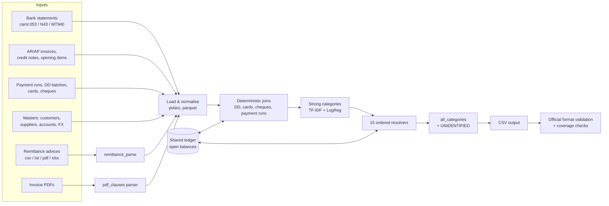

# Token Co. | Intelligent Bank Reconciliation

Talky × Anthropic "Close the Books" hackathon. Every bank movement of a multi-entity group (17 legal entities in LIVE; the organisers'
POLICIES announce a new South African subsidiary, ZA01 / ZAR, for FINAL) must be matched to the invoices it settles, or explained with a category, and every
difference must carry the right accounting exception.

Our pipeline reads half a year of bank statements, invoices, credit notes, payment files, remittance advices and invoice PDFs,
and writes one row per allocation: `bank_txn_id, item_id, amount, category, exception`. It is precision-first: a resolver
claims a bank line only when its evidence gives exactly one answer; otherwise it abstains and leaves the line to a later stage.

## Our approach

A **hybrid of deterministic accounting rules and two small ML models**, arranged as a priority cascade:

1. **Exact structural joins** first: direct-debit batches, card settlements, cheque deposits, AP payment runs and their returns.
2. **Document evidence** next: remittance advices (what the customer says it paid) and clauses printed on invoice PDFs
   (instalments, retentions, advances, cancel-and-replace).
3. **Customer matching**: identify the payer from name, IBAN or cited document numbers, then find the invoice or invoice set
   whose open amounts explain the cash, including discounts, FX and bank charges.
4. **Harder cases** last: unreferenced partial payments (learned ranker), unique exact subsets of recently due invoices,
   repeated payments.
5. **Everything else** is categorised (fees, payroll, cash pool, unidentified receipts) by a text classifier.

A **shared allocation ledger** sits underneath: after every stage the accepted allocations are replayed in bank-date order
against the opening balances, so each later stage sees what is really still open.

## System architecture



- **Ingestion** (`src/bankrec/data.py`, `eda/00_to_parquet.py`): CSV to parquet; FINAL reads updated masters from `final/masters_final/`.
- **Document parsing**: `src/bankrec/remittance_parse.py` turns advices into (document, gross, paid) lines;
  `src/bankrec/pdf_clauses.py` extracts clauses from invoice PDFs of the current and earlier phases (an invoice still open
  keeps the clause of the PDF it was issued with).
- **Orchestration** (`src/bankrec/pipeline.py`): resolvers run in a fixed order on the still-pending lines; a claimed line
  leaves the pending set, so a later resolver can never override an earlier allocation. A resolver that crashes stops the
  run (no silent skip) unless `--safe` is given.
- **Shared ledger** (`pipeline.py`, `apply_ledger`): replays accepted allocations against opening balances; fully clearing
  exceptions consume the full open amount; RETURNED lines can reopen items.
- **Validation**: the pipeline validates the output format before writing; `tools/official_check.py` runs the official
  scorer's validator and checks bank-line coverage and over-allocation.

## Fifteen-stage reconciliation pipeline

After the deterministic joins and strong categories, fifteen resolvers run in this order (`tools/final_config.sh`):

| # | Resolver | What it does |
|---|---|---|
| 1 | `remittance` | Allocates a receipt to the invoices listed in its remittance advice, attributing discounts and withholdings. |
| 2 | `pdf_clauses` | Matches instalments, retentions, advances and replaced invoices using the terms printed on the invoice PDF. |
| 3 | `c_bank_charges_early` | Cross-border receipt short by an intermediary fee (≤ 60 EUR eq. and ≤ 2 %) → `SHORT_BANK_CHARGES`. |
| 4 | `ar_text` | Main customer matcher: payer from name / IBAN / cited documents, then exact invoices, subsets and value modes (discount, overpayment, duplicate). Never uses an invoice issued after the payment. |
| 5 | `ar_exact` | Exact- and adjusted-amount matches with customer evidence. |
| 6 | `ar_multi` | Multi-invoice bundles from cited document numbers, with credit-note netting. |
| 7 | `c_partial` | Learned ranker chooses the invoice of an unreferenced partial payment (`PARTIAL`). |
| 8 | `c_discount` | Early-payment discount receipts (`SHORT_DISCOUNT`). |
| 9 | `c_bank_charges` | Late pass for bank-charge shortfalls. |
| 10 | `c_fx` | Receipts in another currency than the invoice (`FX_DIFFERENCE`). |
| 11 | `ar_due_subset` | Last resort: the unique exact subset of the payer's recently due invoices. |
| 12 | `c_duplicates` | A line repeating an item that an earlier line already paid in full → `DUPLICATE_PAYMENT` (otherwise allocated with no exception). |
| 13 | `c_overpayment` | An unexplained receipt that exceeds exactly one open invoice of the evidenced payer by a round top-up, when no combination of open documents explains it exactly → `OVERPAYMENT`. |
| 14 | `c_ptail` | Unclaimed receipt = one or more invoices paid in full plus exactly one invoice paid at 40 %, 50 % or 60 % (`PARTIAL`); unique solution only, otherwise abstain. |
| 15 | `c_contig` | Unclaimed receipt = the only contiguous run (>= 2) of the payer's open invoices in due-date order whose sum equals the cash to the cent. |

`all_categories` finally labels every remaining line (`UNIDENTIFIED` gets its exception when the classifier gives it
probability ≥ 0.20).

## Machine learning

| Model | Where | Algorithm (verified in source) | Predicts |
|---|---|---|---|
| Category classifier | `src/bankrec/categories.py` | scikit-learn `TfidfVectorizer` (character 2-4-grams) + `LogisticRegression` | Category of a bank line (or ITEM) with probabilities |
| Partial-payment ranker | `src/bankrec/c_partial.py` | LightGBM `LGBMClassifier` | Which open invoice an unreferenced partial payment belongs to |

Both are trained offline on TRAIN labels only (features use history strictly before each line) and loaded at inference from
pinned `.joblib` files, checked by SHA-256. Everything else is deterministic rules and bounded search (Aho-Corasick name and
document matching, exact subset sums).

**At inference the pipeline runs only these two pinned ML models; no LLM is called.** (No LLM client library is imported
anywhere in `src/`.) Claude Code was our development tool: writing and reviewing code, running read-only audits and
coordinating experiments.

## Results

**Official FINAL: 94.45** (submission `s_4e72952fe59dd2cab5c7`, 15 resolvers, commit `006a2c4`, merged here).

| Metric | FINAL (15 resolvers) | FINAL first submission (13 resolvers) | LIVE (13 resolvers) |
|---|---|---|---|
| Score | **94.45** | 94.27 | 93.98 |
| Allocation F1 | 0.9443 | 0.9428 | 0.9372 |
| Allocation precision / recall | 0.9884 / 0.9039 | 0.9890 / 0.9008 | 0.9883 / 0.8912 |
| Transaction accuracy | 0.9624 | 0.9598 | 0.9565 |
| Exception macro-F1 | 0.9180 | 0.9169 | 0.9209 |
| Bank lines covered | 220,256 / 220,256 | 220,256 / 220,256 | 203,083 / 203,083 |
| Output rows | 768,423 | 766,150 | 707,351 |

Clean, time-separated TRAIN holdouts (official scorer; 2025-H1 with models trained to 2024-12, 2024-H2 with models trained to
2024-06; remittance advices and PDFs only from the current and earlier phases):

| Pipeline | 2025-H1 | 2024-H2 |
|---|---|---|
| DC7 (12 resolvers) | 94.18 | 93.89 |
| DC7+C (13 resolvers, first FINAL file) | 94.36 | 94.10 |
| + `c_ptail` | 94.50 | 94.25 |
| + `c_ptail` + `c_contig` (submitted) | **94.58** | **94.33** |

FINAL run: ~216 s, peak memory ~29.7 GB (local Mac). LIVE (DC7+C): ~181 s / ~23.3 GB.

## Reproducibility

Data and model binaries are **not** in the repository (competition data is downloaded from the hackathon site; models are
trained locally). See `docs/DEVELOPMENT_ES.md` for data download and parquet conversion.

```bash
python3.12 -m venv .venv && source .venv/bin/activate
pip install -r requirements.txt
python eda/00_to_parquet.py                                   # data/<phase>/*.csv.gz -> data/parquet/<phase>/
(cd src && python -m bankrec.categories --train --all)        # category model (models/, not in git)
(cd src && python -m bankrec.c_partial --train --to 2025-07-01)  # partial-payment model (models/c_partial_2025-07-01.joblib)

export PYTHON_BIN="$PWD/.venv/bin/python"
export BANKREC_CAT_MODEL=/absolute/path/to/cat_all.joblib
export BANKREC_PARTIAL_MODEL=/absolute/path/to/c_partial_2025-07-01.joblib
bash tools/run_candidate.sh live out/live_candidate.csv.gz    # preflight, pipeline, official checks; never submits
```

- `tools/final_config.sh` holds the exact configuration (resolver order, shared ledger, `PYTHONHASHSEED=0`, thresholds) and
  the SHA-256 pins of the two models used for our LIVE submission. A freshly trained model will have a different hash and
  `tools/preflight.py` will refuse it unless `BANKREC_ALLOW_UNPINNED_MODELS=1` is set deliberately.
- FINAL: `bash tools/prepare_final.sh --skip-train` (download, extract, parse, preflight, pipeline). See `docs/FINAL_READINESS.md`.

## Reliability and limitations

**Safeguards implemented:** preflight checks (configuration drift, dependencies, every resolver loaded, model hashes, hash
seed inherited at start-up), failure propagation in the runbook scripts, official format validation, bank-line coverage and
over-allocation reports, a time-separated validation protocol with no future documents.

**Robustness audit verdict: CONDITIONAL GO.** Controlled stress tests showed deterministic output (identical across repeated
and row-shuffled runs on the sample phase), clean failure on missing columns, and correct behaviour for a new entity with a
new currency and renamed customers (synthetic test: FINAL's actual ZA01 data has not been seen yet). The condition is that FINAL inputs pass the data checks, because some failures are silent:

- **Unfamiliar remittance layouts**: an advice the parser cannot read is skipped. Remittance-matched lines carry a large
  share of the score (on 2024-H2, losing 10 % of them would cost about 1.4 points). FINAL introduces a new layout.
- **Missing input tables** silently disable their resolvers (a missing payment-run file cost ~9.6 points on the sample phase).
- **Hard cases remain hard**: many-to-many bundles (LIVE segment accuracy 0.28), late discounts (0.61), credit-note bundles
  (0.67) and overpayments (0.75).
- A small tie-breaking non-determinism in `ar_multi` can change a few lines between runs; expected score effect is negligible.

## Future improvements

- Layout-agnostic remittance reading (any document number confirmed by amount and party) instead of format-specific parsers.
- Better many-to-many and partial-bundle matching with explicit ambiguity handling.
- Stronger safeguards: reject double allocation of already settled items unless a duplicate is evidenced; date-aware ledger
  balances for every resolver.
- Operational monitoring: per-format parse coverage and per-resolver output alerts in the run report.

## Team

**Token Co.**: Jack, Liam and Diego.
